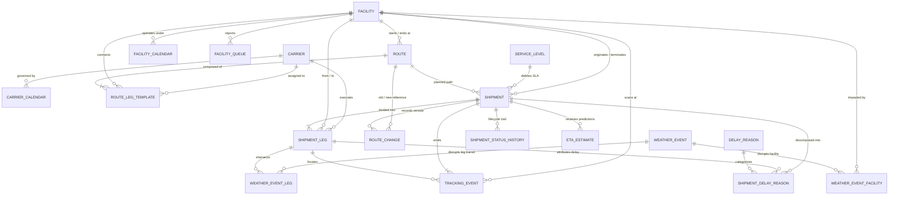

# Entity-Relationship Diagram & Schema Architecture

This document defines the formal relational data model for the YottaFlex AI synthetic logistics network, including primary keys, foreign keys, bridge tables, and exact relational cardinalities.

---

### Mermaid ER Diagram

---

### Cardinality Matrix

| Parent Entity | Child Entity | Cardinality | Parent PK | Child FK | Lifecycle / Cascade Policy |
|---|---|---|---|---|---|
| `Carrier` | `CarrierCalendar` | 1 : N | `carrier_id` | `carrier_id` | Mandatory; carrier operating hours & holiday rules |
| `Carrier` | `RouteLegTemplate` | 1 : N | `carrier_id` | `carrier_id` | Master route planning assignment |
| `Carrier` | `ShipmentLeg` | 1 : N | `carrier_id` | `carrier_id` | Execution carrier for the active leg |
| `Facility` | `FacilityCalendar` | 1 : N | `facility_id` | `facility_id` | Operational hours, gate open/close, holidays |
| `Facility` | `FacilityQueue` | 1 : N | `facility_id` | `facility_id` | Hourly queue length & wait time snapshots |
| `Facility` | `Shipment` | 1 : N | `facility_id` | `origin_facility_id`, `destination_facility_id` | Origin and final delivery destination |
| `Facility` | `ShipmentLeg` | 1 : N | `facility_id` | `from_facility_id`, `to_facility_id` | Leg hop boundaries |
| `Facility` | `TrackingEvent` | 1 : N | `facility_id` | `facility_id` | Nullable for open-road telemetry; populated at depots |
| `ServiceLevel` | `Shipment` | 1 : N | `service_level_id` | `service_level_id` | Governs target & grace hours |
| `Route` | `RouteLegTemplate` | 1 : N | `route_id` | `route_id` | Ordered 1 to 4 sequential template legs |
| `Route` | `Shipment` | 1 : N | `route_id` | `route_id` | Baseline planned route |
| `WeatherEvent` | `WeatherEventFacility` | 1 : N | `weather_event_id` | `weather_event_id` | Bridge table connecting storm/disruption to facilities |
| `WeatherEvent` | `WeatherEventLeg` | 1 : N | `weather_event_id` | `weather_event_id` | Bridge table connecting storm/disruption to transit legs |
| `Shipment` | `ShipmentLeg` | 1 : N | `shipment_id` | `shipment_id` | Ordered by `leg_sequence` (1..4) |
| `Shipment` | `TrackingEvent` | 1 : N | `shipment_id` | `shipment_id` | Immutable stream ordered by `sequence_no` |
| `Shipment` | `ShipmentStatusHistory` | 1 : N | `shipment_id` | `shipment_id` | Append-only status transition log |
| `Shipment` | `ShipmentDelayReason` | 1 : N | `shipment_id` | `shipment_id` | Additive delay decomposition bridge |
| `Shipment` | `RouteChange` | 1 : N | `shipment_id` | `shipment_id` | Rerouting audit record (old route $\to$ new route) |
| `Shipment` | `ETAEstimate` | 1 : N | `shipment_id` | `shipment_id` | Point-in-time ETA snapshots |
| `DelayReason` | `ShipmentDelayReason` | 1 : N | `delay_id` | `delay_id` | Taxonomy lookup for delay attribution |
