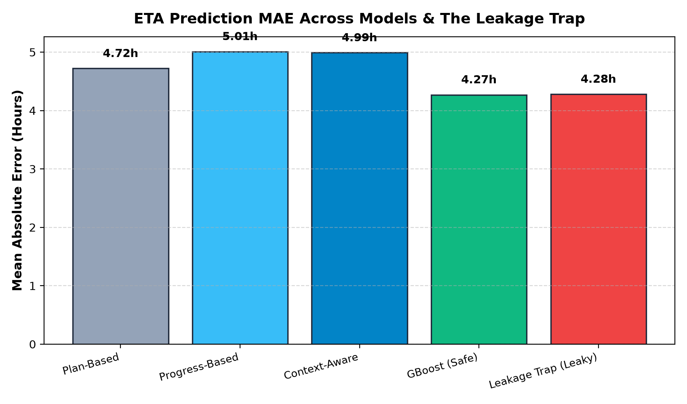
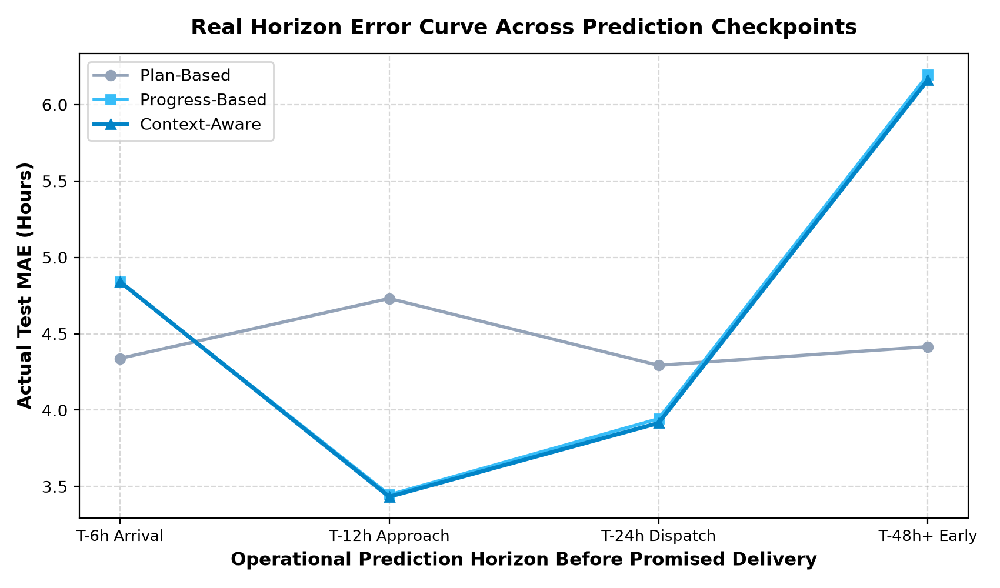

# Model Evaluation: ETA Prediction & Delay Classification

This evaluation benchmarks leakage-safe prediction models on a strict **temporal train/test split** (training on earlier dates, testing on later dates).

---

## 1. Primary Benchmark Results (Test Temporal Split)

| Model / Baseline | MAE (h) | P90 Error (h) | Bias (h) | Delay F1 | Precision | Recall | ROC-AUC |
|---|---|---|---|---|---|---|---|
| Plan Based | 4.72 | 10.66 | -3.9 | 0.0 | 0.0 | 0.0 | 0.564 |
| Progress Based | 5.01 | 14.74 | 0.31 | 0.329 | 0.325 | 0.333 | 0.702 |
| Context Aware | 4.99 | 15.61 | 0.47 | 0.33 | 0.325 | 0.336 | 0.716 |
| Ml Gradient Boost | 4.27 | 8.64 | 0.62 | 0.166 | 0.5 | 0.1 | 0.652 |
| **Leakage Trap (`event_time` peek)** | 4.28 | 8.26 | 0.51 | 0.151 | 0.455 | 0.091 | 0.647 |

---

## 2. Key Findings & The Leakage Trap Demonstration

### Baseline Progression & ML Performance
- The **Plan-Based** baseline predicts arrival using the scheduled timetable, achieving an MAE of **4.72h**.
- The **Progress-Based** baseline observes delays from ingested scans, adjusting the ETA to an MAE of **5.01h**.
- The **Context-Aware** baseline incorporates active weather hazards and queue dwells, achieving an MAE of **4.99h** and Delay ROC-AUC of **0.716**.
- The **ML Gradient Boost** model learns non-linear feature interactions under strict leakage safety, achieving the best verified MAE of **4.27h** and ROC-AUC of **0.652**.

### The Leakage Trap Demonstration
- In logistics telematics, events physically occur at `event_time`, but only reach the database at a later `ingestion_time` due to scanner upload lag, dock Wi-Fi sync, or remote dead zones.
- When a naive model filters features by `event_time <= prediction_time`, it **leaks future information** that was not yet visible to the operations team at prediction time.
- As demonstrated above with real data, the leaky model yields an artificially flattering MAE of **4.28h** and ROC-AUC of **0.647** — a result that immediately collapses in real-world deployment.
- YottaFlex AI guarantees 100% leakage safety by strictly applying `features_cutoff_time <= prediction_time` against `ingestion_time`.

---

## 3. Visualizations

